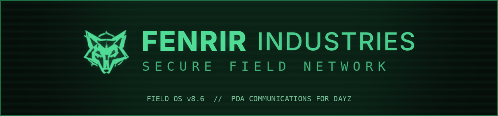
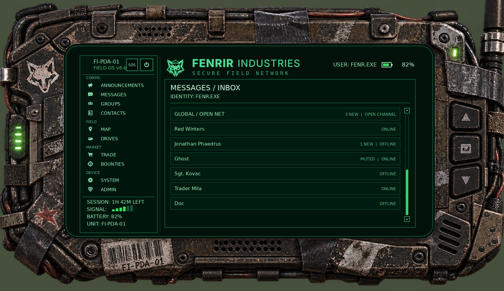
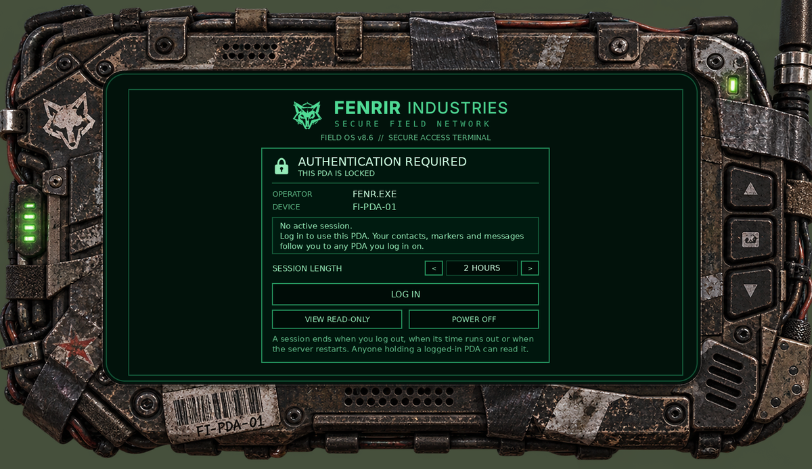
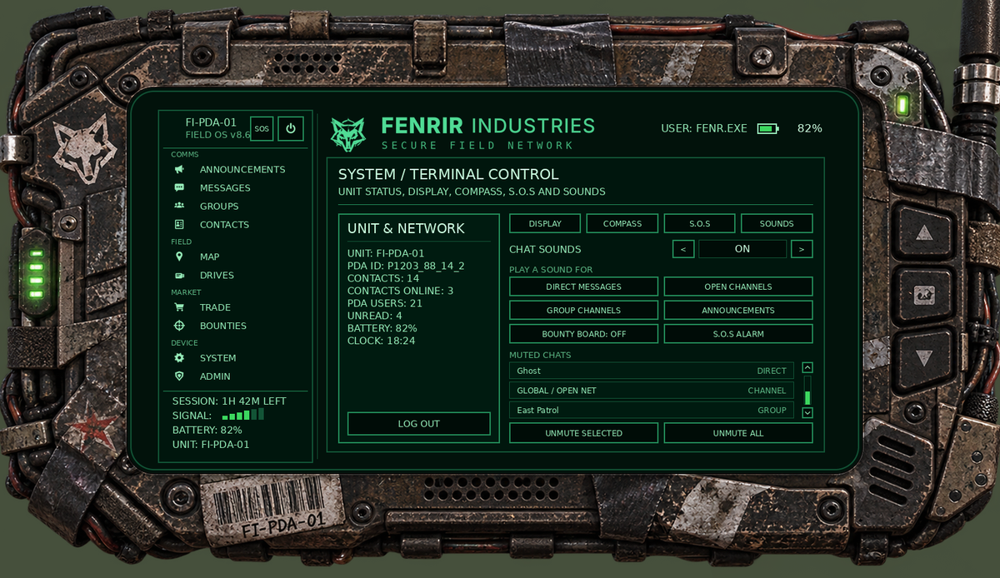

<div align="center">



# Fenrir Industries PDA

**A full in-game PDA for DayZ: secure messaging, private group channels, a live compass HUD, S.O.S beacons, trade and bounty boards, data drives and a VPP-backed admin console — all inside a weathered field terminal.**


[Features](#-features) ·
[Screenshots](#-screenshots) ·
[Installation](#-installation) ·
[Configuration](#%EF%B8%8F-configuration) ·
[Building](#-building-from-source) ·
[Changelog](CHANGELOG.md) ·
[Server guide](docs/SERVER_OWNER_GUIDE.md)

</div>

---

## ✦ Features

### 📡 Communications
- **Direct messages** between players, with online/offline status, offline delivery and full history that follows the player.
- **Open channels** — Global and Buy/Sell — plus server **Announcements** with pop-up bulletins.
- **Private group channels** with owners, member management and unread counts.
- **Contacts** with rename, block and reputation.
- **Per-chat sound muting** and a SYSTEM › SOUNDS panel to control exactly which traffic makes noise.

### 🔐 Login sessions
- A PDA is **dead until someone logs in** — no compass, no pop-ups, no S.O.S.
- Players choose a **session length** (1–4 h by default). Sessions end on logout, timeout, a new login or server restart.
- **Steal a logged-in PDA and you can read it** — messages, groups, markers, live traffic — but never transmit from it.
- A player's contacts, markers and history **follow them to any PDA** they log in on.

### 🧭 Navigation
- **Compass HUD** with **7 styles** (Classic, Tactical, Minimal, Bezel, Arc, Radar, Slim), marker dots on the strip, distances and headings.
- **Map** on any terrain the server runs, centred on you, with marker pins, a heading arrow and S.O.S beacons.
- Place, rename and delete **map markers** that also appear on the compass.

### 🚨 S.O.S
- Double-tap the S.O.S key (default <kbd>End</kbd>) or use the sidebar button.
- Chosen contacts or a group get your grid, a red ping on map and compass and an alarm.
- The signal **burns out the PDA**, its battery and every drive in it — a last resort.

### 💾 Data drives
- **Encrypted Drives** — write conversations, group chats and marker sets for others to read; data degrades after a set time.
- **Intel Drives** — lore files from an admin-defined pool, or custom intel written by admins. **Single use:** decrypt once, then the drive burns out.
- Clone a stolen, logged-in PDA onto an Encrypted Drive.

### 🛒 Boards
- **Trade board** with categories, listings, ratings and reputation.
- **Bounty board** with posting, claims and confirmation.
- Both optional from the server config.

### 🛡️ Administration (VPP Admin Tools)
- **Archive** — searchable log of every message: who sent what, to whom, and when.
- **Players** — who is logged in, on whose PDA, or locked.
- **Broadcast** — server-wide announcements with a full preview.
- **Intel** — write custom intel to a drive.
- Every written drive is logged with its full contents.

### 🎨 Personalisation
- **10 theme presets** plus custom hue, saturation, brightness and backlight — the whole PDA, pop-ups and compass recolour instantly.
- **Server branding:** replace the name, tagline and logo (or use your own banner art) from the server config.

---

## 📸 Screenshots

<div align="center">



<sub><b>Messages</b> — inbox with channels and contacts, grouped sidebar</sub>

<br><br>


&nbsp;


<sub><b>Login</b> — every PDA starts locked &nbsp;·&nbsp; <b>System › Sounds</b> — per-type switches and muted chats</sub>

</div>

---

## 📦 Installation

### Requirements

| Mod | Why |
|---|---|
| [Community Framework](https://steamcommunity.com/sharedfiles/filedetails/?id=1559212036) | RPC layer |
| [VPP Admin Tools](https://steamcommunity.com/sharedfiles/filedetails/?id=1828439124) | Admin permissions |

### Server
1. Add the packed mod (and its `.bikey`) to your server and to the client mod list, loading **after** CF and VPP Admin Tools.
2. Start the server once. The config is created at `$profile:\PDA\Config\FenrirIndustriesPDA.json`.
3. Add the items to your `types.xml` (see the [server guide](docs/SERVER_OWNER_GUIDE.md#new-items)):

   | Class | Item |
   |---|---|
   | `FENR_PDA_Device` | The PDA (takes a 9V battery and three drive slots) |
   | `FENR_PDA_FlashDrive` | Flash drive |
   | `FENR_PDA_IntelDrive` | Intel Drive |
   | `FENR_PDA_EncryptedDrive` | Encrypted Drive |

4. Admins are players with any VPP Admin Tools menu permission. The ADMIN tab appears on their own logged-in PDA.

### Players
- Hold a powered PDA and open it, then **log in** and pick a session length.
- Bind **Fenrir PDA: S.O.S (double-tap)** under *Controls* (default <kbd>End</kbd>).
- Theme, compass and sound settings are saved on your own PC.

---

## ⚙️ Configuration

The server config is `$profile:\PDA\Config\FenrirIndustriesPDA.json`; missing keys are added with their defaults on start. A full example is in [`docs/FenrirIndustriesPDA.example.json`](docs/FenrirIndustriesPDA.example.json).

<details>
<summary><b>Most-used keys</b></summary>

| Key | Default | |
|---|---|---|
| `TradeEnabled` / `BountyEnabled` | `true` | Show the trade / bounty boards |
| `SosEnabled` | `true` | Allow S.O.S signals |
| `SosMaxContacts` | `5` | Contacts one S.O.S can reach |
| `SosPingMinutes` | `30` | How long an S.O.S ping stays on map and compass |
| `SessionMinHours` / `SessionMaxHours` | `1` / `4` | Login session lengths players can choose |
| `MessageLogsDays` | `14` | Message log (and chat history) retention |
| `EncryptedDriveDays` | `7` | Encrypted Drive data lifetime |
| `DriveLogsDays` | `7` | Drive write log retention |
| `DeviceInactiveDays` | `30` | Erase a player's PDA memory after this many days away |
| `BatteryDrainEnabled` | `true` | Drain the battery while the PDA is open |

</details>

<details>
<summary><b>Branding your server</b></summary>

```json
"BrandName": "DEADFALL SURVIVAL",
"BrandTagline": "EAST SECTOR COMMS",
"BrandNetwork": "DEADFALL COMMS",
"BrandLogo": "MyServerMod/gui/pda_logo.edds",
"BrandLogoTinted": true,
"BrandBanner": ""
```

Logos and banners must ship in a mod your players load (`.edds` or `.paa`). See the [server guide](docs/SERVER_OWNER_GUIDE.md#branding) for sizes.

</details>

Everything else — data files, intel pool, retention, rate limits — is covered in the **[Server Owner Guide](docs/SERVER_OWNER_GUIDE.md)**.

---

## 🔧 Building from source

```text
P:\FENR_PDA\              ← this repository
├─ PDA\                   ← the mod (PBO prefix FENR_PDA\PDA) — pack this folder
│  ├─ config.cpp
│  ├─ scripts\            3_Game · 4_World · 5_Mission
│  ├─ gui\                layouts, frame art, UI textures
│  ├─ data\               models, materials, textures, keybinds
│  ├─ sounds\
│  └─ languagecore\       stringtable
├─ tools\                 layout / texture generators (Python)
├─ docs\                  server guide, example config, images
├─ CHANGELOG.md
└─ README.md
```

1. Clone or copy the repository to **`P:\FENR_PDA`**.
2. Pack **`P:\FENR_PDA\PDA`** with pboProject (or Addon Builder) and sign it with your key.
3. Only `PDA\` goes into the PBO; everything else stays in the repository.

The UI layouts and textures are generated. To change them, edit the scripts in [`tools/`](tools/README.md) and re-run them rather than editing the outputs by hand.

---

## 📜 Changelog

See **[CHANGELOG.md](CHANGELOG.md)**. Latest: **v8.6** — new `FENR_PDA\PDA` prefix, marker-dot compass fixes and cleanup.

---

<div align="center">

**Fenrir Industries PDA** · © Fenr.EXE · Maintained by Fenr.EXE

<sub>See <a href="PDA/COPYRIGHT.txt">COPYRIGHT.txt</a> for terms.</sub>

</div>
